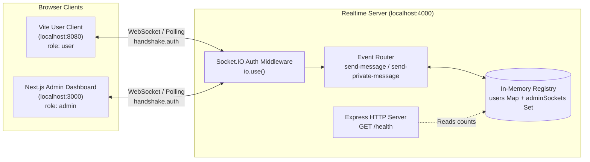

# Realtime Communication System

[](https://nodejs.org/)
[](https://socket.io/)
[](https://expressjs.com/)
[](./LICENSE)
[](https://www.conventionalcommits.org/)

A lightweight, role-aware realtime communication boilerplate built with **Express** and **Socket.IO**, paired with drop-in React reference components for a **Next.js Admin Dashboard** and a **Vite User Client**. Designed for customer support chat, admin broadcasts, targeted private messaging, and real-time online presence tracking.

---

## ⚡ Quick Start

Boot the local realtime server in 3 commands:

```bash
# 1. Clone the repository
git clone https://github.com/digitalterrene/realtime-comm.git
cd realtime-comm

# 2. Install dependencies
npm install

# 3. Start the server (with hot reload via nodemon)
npm run dev-server
```

Verify the server is healthy:

```bash
curl http://localhost:4000/health
# {"status":"healthy","users":0,"admins":0}
```

Default local endpoints:
- **Socket.IO & HTTP Server**: `http://localhost:4000`
- **Health Check Endpoint**: `http://localhost:4000/health`
- **Allowed Admin Origin (Next.js)**: `http://localhost:3000`
- **Allowed Client Origin (Vite)**: `http://localhost:8080`

---

## 🏗️ System Architecture



### Key Capabilities
- **Handshake Authentication**: Validates `userId` and `role` (`admin` | `user`) in `io.use()` before upgrading the socket connection.
- **User-to-Admin Messaging**: End-user messages (`send-message`) are routed exclusively to all connected admin sockets.
- **Admin Broadcasts**: Admin `send-message` events broadcast to every connected client (`io.emit`).
- **Admin-to-User Private Messaging**: Admin `send-private-message` events route directly to a target user socket and echo back to the sender admin.
- **Live Presence Tracking**: Admins receive the full `user-list` upon connecting, plus incremental `user-connected` and `user-disconnected` notifications.
- **Health Monitoring**: `GET /health` exposes live socket and admin counts for load balancers and smoke tests.

---

## 📚 Documentation Architecture

This repository follows the **4-Tier Senior Documentation Architecture**:

| Tier | Document | Purpose |
|---|---|---|
| **Tier 1: Governance** | [CONTRIBUTING.md](./CONTRIBUTING.md) | Branching, Conventional Commits, PR lifecycle, local checks |
| **Tier 1: Governance** | [SECURITY.md](./SECURITY.md) | Vulnerability reporting, SLAs, production security notice |
| **Tier 1: Governance** | [Git Engineering Standards](./docs/git-standards.md) | Non-negotiable git hygiene and Chain-of-Thought commit rules |
| **Tier 2: Architecture** | [System Design & Topology](./docs/architecture/system-design.md) | Sequence diagrams, state machines, Socket.IO event contract, HTTP API |
| **Tier 2: Architecture** | [Data Model & State Schemas](./docs/architecture/data-model.md) | In-memory registries, message payload schemas, complexity, DB migration ERD |
| **Tier 2: Architecture** | [Security & RBAC Matrix](./docs/architecture/security-and-rbac.md) | Auth flow, RBAC permission matrix, CORS, threat model & hardening checklist |
| **Tier 3: Decisions** | [Architecture Decision Records](./docs/adr/README.md) | Immutable log of architectural trade-offs (`ADR-001` through `ADR-003`) |
| **Tier 4: Operations** | [Deployment Verification Runbook](./docs/runbooks/deployment-verification.md) | Post-deploy smoke tests, health/CORS/Socket.IO checks, rollback criteria |
| **Tier 4: Operations** | [Incident Response Runbook](./docs/runbooks/incident-response.md) | Triage flowchart, common failure modes, diagnostics, recovery steps |

---

## 📁 Workspace Structure

```text
realtime-comm/
├── server.js                              # Express HTTP + Socket.IO server entry point
├── admin/
│   └── index.js                           # Next.js AdminChatBox reference component
├── client/
│   └── index.js                           # Vite UserChatBox reference component
├── docs/
│   ├── git-standards.md                   # Git hygiene & Conventional Commits rules
│   ├── architecture/                      # Tier 2: System design, data model, security/RBAC
│   ├── adr/                               # Tier 3: Architecture Decision Records
│   └── runbooks/                          # Tier 4: Deployment & incident runbooks
├── .github/
│   ├── PULL_REQUEST_TEMPLATE.md           # Standardized PR checklist
│   └── ISSUE_TEMPLATE/                    # Bug report & feature request templates
├── .env.example                           # Environment variable template
├── package.json                           # Server runtime dependencies & npm scripts
├── CONTRIBUTING.md                        # Contribution guidelines
├── SECURITY.md                            # Security policy & disclosure SLAs
└── LICENSE                                # MIT License
```

---

## 🔌 Socket.IO Event Quick Reference

| Event | Direction | Authorized Role | Payload | Behavior |
|---|---|---|---|---|
| `user-list` | Server → Admin | `admin` | `string[]` | Sent to admin on connect with all online user IDs |
| `user-connected` | Server → Admin | `admin` | `string` (`userId`) | Notifies all admins when a user connects |
| `user-disconnected` | Server → Admin | `admin` | `string` (`userId`) | Notifies all admins when a user disconnects |
| `send-message` | Client → Server | `user` \| `admin` | `{ text: string }` | User: forwards to all admins. Admin: broadcasts to all sockets |
| `send-private-message` | Admin → Server | `admin` | `{ targetUserId, text }` | Routes privately to target user and echoes to sender admin |
| `receive-message` | Server → Client | `user` \| `admin` | `MessagePayload` | Delivers public, broadcast, or private message with ISO timestamp |

For full payload schemas and sequence diagrams, see [docs/architecture/system-design.md](./docs/architecture/system-design.md).

---

## 🧩 Integrating the Reference UI Components

`admin/index.js` and `client/index.js` are standalone React reference components designed to be dropped into your frontend apps.

### Prerequisites in Frontend Apps
1. Install `socket.io-client` (`npm install socket.io-client`).
2. Install [shadcn/ui](https://ui.shadcn.com/) components: `Card`, `Input`, `Button`, and `Select` (admin only).
3. For `client/index.js`, provide a `UserContext` exporting `useUser()` returning `{ user: { id: string } }`.

### Component Integration Paths
- **Next.js Admin Dashboard** (port `3000`): Copy `admin/index.js` into your App Router route (e.g., `app/admin/chatbox/page.jsx`).
- **Vite User Client** (port `8080`): Copy `client/index.js` into your chat route/component (e.g., `src/components/UserChatBox.jsx`).

> [!IMPORTANT]
> Before deploying to production, replace the boilerplate handshake identity check with signed token verification (e.g., JWT) and memoize the Socket.IO client instance inside `useRef`/`useEffect`. See [Security & RBAC](./docs/architecture/security-and-rbac.md) for the full hardening checklist.

---

## ⚙️ Environment Configuration

Copy `.env.example` to `.env` if overriding defaults:

| Variable | Description | Required | Default |
|---|---|---|---|
| `PORT` | TCP port for the Express HTTP and Socket.IO server | No | `4000` |
| `NODE_ENV` | Runtime environment (`development`, `staging`, `production`) | No | `development` |

> [!WARNING]
> Never commit `.env` files, private keys (`*.pem`, `*.key`), or credentials to version control.

---

## 🛠️ Available Scripts

| Command | Description |
|---|---|
| `npm run start-server` | Start the Express/Socket.IO server with `node server.js` |
| `npm run dev-server` | Start the server with auto-restart via `nodemon server.js` |
| `node .agents/skills/senior-repo-standards/scripts/audit-hygiene.js` | Run the repository hygiene & documentation compliance audit |

---

## 🤝 Contributing

We welcome contributions. Please review [CONTRIBUTING.md](./CONTRIBUTING.md) and [docs/git-standards.md](./docs/git-standards.md) before opening a pull request.

## 🛡️ Security

To report a security vulnerability, follow the responsible disclosure process in [SECURITY.md](./SECURITY.md).

## 📄 License

This project is licensed under the [MIT License](./LICENSE).
