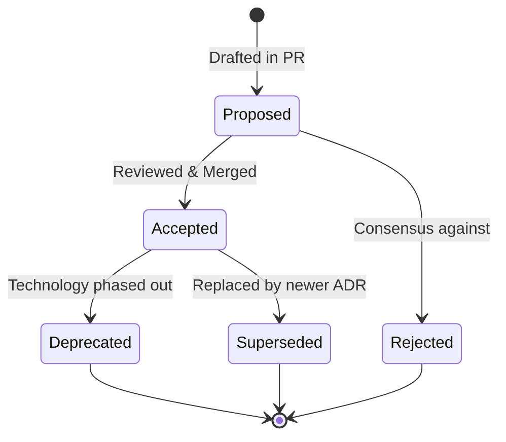

# Architecture Decision Records (ADRs)

This directory contains immutable records of architecturally significant decisions made for **Realtime Communication System**.

## ADR Index

| ADR | Title | Status | Date |
|---|---|---|---|
| [ADR-000](./ADR-000-template.md) | Architecture Decision Record Template | Template | 2026-11-22 |
| [ADR-001](./ADR-001-socketio-over-raw-websockets.md) | Adopt Socket.IO v4 over Raw WebSockets and SSE | Accepted | 2026-11-22 |
| [ADR-002](./ADR-002-in-memory-connection-registry.md) | Use In-Memory `Map` and `Set` Connection Registry for Single-Node Boilerplate | Accepted | 2026-11-22 |
| [ADR-003](./ADR-003-handshake-auth-middleware-rbac.md) | Enforce Connection-Time Handshake Auth Middleware (`io.use`) with Role-Based Routing | Accepted | 2026-11-22 |

## ADR Lifecycle

> [!NOTE]
> Once an ADR is **Accepted**, its decision section must not be altered retroactively. When requirements change, author a new ADR that supersedes the previous one.
