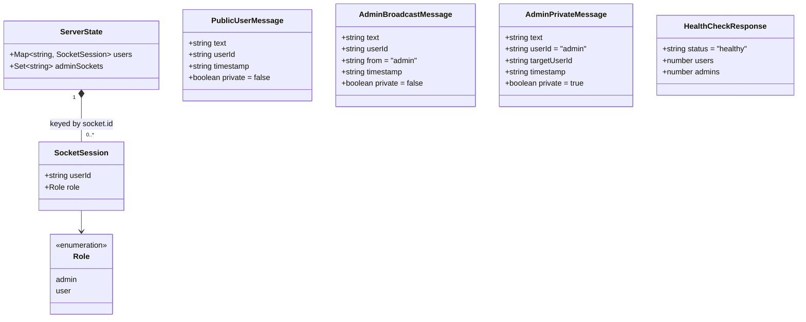
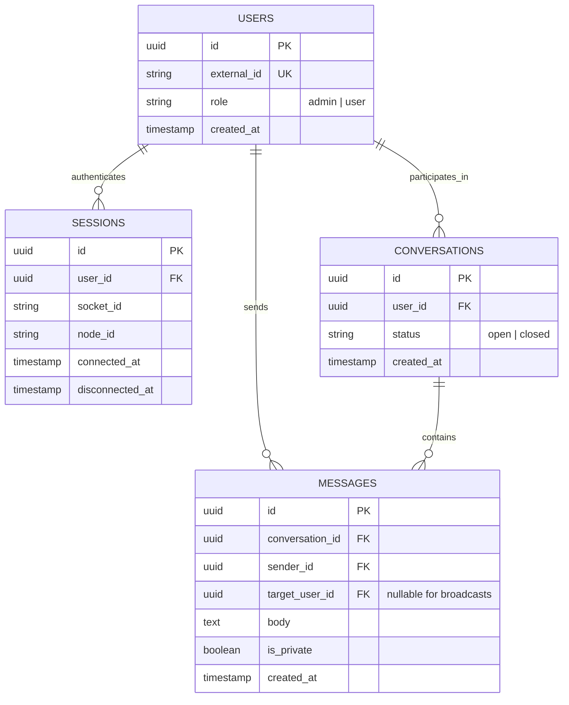

# Data Models & State Schemas

*Status*: Living Architecture Specification  
*Scope*: In-memory runtime state (`server.js`), wire message schemas, and future persistence blueprint.

---

## 1. Runtime In-Memory State (`server.js`)

The current boilerplate stores all connection state in two process-local JavaScript collections, avoiding external database dependencies during local development and prototyping.

### 1.1 State Class Diagram



### 1.2 Collection Specifications & Time Complexity

| Structure | Type | Key / Element | Operations & Complexity |
|---|---|---|---|
| `users` | `Map<socketId, { userId, role }>` | Key: `socket.id` (`string`) | Insert on connect: `O(1)` <br> Lookup on message/disconnect: `O(1)` <br> Delete on disconnect: `O(1)` <br> Build `user-list` for admin: `O(N)` <br> Target lookup in `send-private-message`: `O(N)` linear scan |
| `adminSockets` | `Set<socketId>` | Element: `socket.id` (`string`) | Insert on admin connect: `O(1)` <br> Delete on admin disconnect: `O(1)` <br> Fan-out to all admins: `O(A)` where `A` = active admin count |

> [!NOTE]
> `users.size` includes **both** `user` and `admin` sockets. Therefore, `GET /health` returns total active connections in `users` and the subset of admin connections in `admins`. Active end-user count is `users - admins`.

---

## 2. Wire Payload Schemas

### 2.1 Handshake Auth Object (`socket.handshake.auth`)

```json
{
  "userId": "usr-42a9c1b0",
  "role": "user"
}
```

| Field | Type | Required | Constraints |
|---|---|---|---|
| `userId` | `string` | Yes | Must be truthy (`Boolean(userId) === true`) |
| `role` | `string` | Yes | Strictly `"admin"` or `"user"` |

### 2.2 `receive-message` Payload Variants

All messages delivered by `server.js` share a base envelope with ISO-8601 UTC timestamps (`new Date().toISOString()`):

| Field | User → Admin (`send-message`) | Admin Broadcast (`send-message`) | Admin Private (`send-private-message`) |
|---|---|---|---|
| `text` | `string` | `string` | `string` |
| `userId` | Sender's `userId` | Admin's `userId` (e.g., `admin-xxxxxxxx`) | Literal `"admin"` |
| `from` | *omitted* | Literal `"admin"` | *omitted* |
| `targetUserId` | *omitted* | *omitted* | Recipient's `userId` |
| `timestamp` | ISO-8601 string | ISO-8601 string | ISO-8601 string |
| `private` | `false` | `false` | `true` |

---

## 3. Production Persistence Blueprint (Future Evolution)

When migrating from the in-memory boilerplate to persistent message history and multi-instance deployments, introduce a relational schema (e.g., PostgreSQL) paired with Redis for ephemeral presence:



### Recommended Production Indexes
- `MESSAGES (conversation_id, created_at DESC)` for paginated chat history queries.
- `SESSIONS (user_id) WHERE disconnected_at IS NULL` for active multi-tab presence lookups.
- Redis Pub/Sub via `@socket.io/redis-adapter` + Socket.IO Rooms (`room:admins`, `room:user:<userId>`) to eliminate the `O(N)` linear scan in `send-private-message`.
