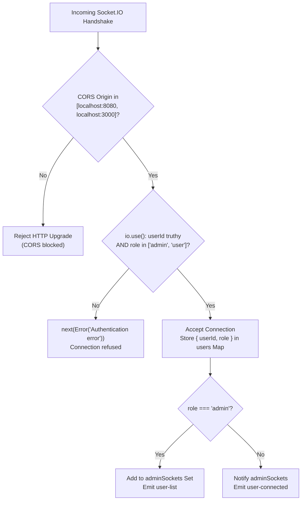

# Security Architecture & Role-Based Access Control (RBAC)

*Status*: Living Architecture Specification  
*Scope*: Authentication middleware, role authorization, CORS policy, threat model, and production hardening.

---

## 1. Authentication & Authorization Flow

Every Socket.IO connection passes through `io.use()` before the `connection` handler executes:

---

## 2. Role-Based Access Control (RBAC) Matrix

| Action / Event | Unauthenticated | `role: "user"` | `role: "admin"` | Enforcement Point |
|---|---|---|---|---|
| `GET /health` | Allowed | Allowed | Allowed | Express route (`server.js:124`) |
| Establish Socket.IO connection | **Denied** | Allowed | Allowed | `io.use()` middleware (`server.js:24-30`) |
| Receive `user-list` | **Denied** | **Denied** | Allowed | `connection` handler (`server.js:39-46`) |
| Receive `user-connected` / `user-disconnected` | **Denied** | **Denied** | Allowed | `adminSockets` fan-out (`server.js:50-52`, `113-115`) |
| Emit `send-message` (to admins) | **Denied** | Allowed | N/A | `send-message` handler (`server.js:67-71`) |
| Emit `send-message` (broadcast to all) | **Denied** | **Denied** | Allowed | `send-message` handler (`server.js:72-78`) |
| Emit `send-private-message` | **Denied** | **Denied** (dropped) | Allowed | `send-private-message` guard (`server.js:84`) |

---

## 3. Transport & CORS Policy

Both Express (`app.use(cors(...))`) and Socket.IO (`new Server(server, { cors: ... })`) enforce an explicit origin allowlist:

- `http://localhost:8080` — Vite User Client
- `http://localhost:3000` — Next.js Admin Dashboard
- Allowed HTTP methods on Socket.IO handshake: `GET`, `POST`

---

## 4. Threat Model & Production Hardening Checklist

> [!WARNING]
> The current boilerplate is optimized for clarity and local prototyping. It **must** be hardened before exposure to untrusted networks.

| Threat | Current Boilerplate Behavior | Production Remediation |
|---|---|---|
| **Role & Identity Spoofing** | Any client can pass `{ userId: "admin-1", role: "admin" }` in `socket.handshake.auth` and gain full admin visibility and broadcast privileges. | Replace raw `userId`/`role` with a signed **JWT** (`auth: { token }`) verified in `io.use()` against a server-side secret or JWKS endpoint; derive `userId` and `role` strictly from verified token claims. |
| **Unencrypted Traffic (MITM)** | Plaintext `http://` and `ws://` on `localhost:4000`. | Terminate TLS 1.3 at a reverse proxy (Nginx, Caddy, Cloudflare, ALB) and enforce `https://` / `wss://`. |
| **Message Flooding / DoS** | No rate limiting or payload size cap on `send-message` or `send-private-message`. | Set `maxHttpBufferSize` on Socket.IO (e.g., `16 * 1024` bytes), enforce per-socket token-bucket rate limits, and validate `typeof message?.text === "string"` with a max character length. |
| **Hardcoded CORS Origins** | Origins are hardcoded to `localhost:8080` and `localhost:3000`. | Load comma-separated `ALLOWED_ORIGINS` from environment variables; never use `origin: "*"` with credentials. |
| **Health Endpoint Exposure** | `GET /health` is unauthenticated and reveals live socket/admin counts. | Restrict `/health` to internal VPC/load-balancer subnets or return minimal `{ status: "ok" }` publicly. |
| **XSS in Client Rendering** | React escapes `{msg.text}` by default, mitigating basic HTML injection. | Preserve plain-text rendering; if Markdown/rich text is ever added, sanitize with DOMPurify and enforce a strict Content-Security-Policy (CSP). |
