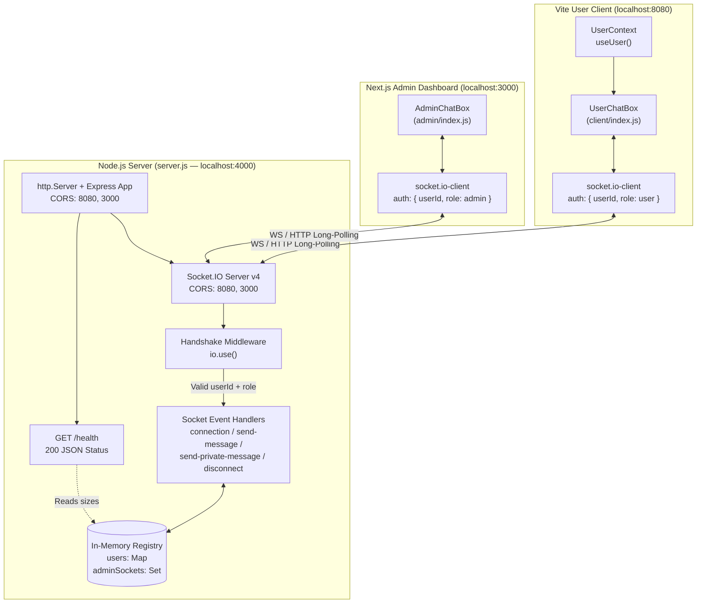
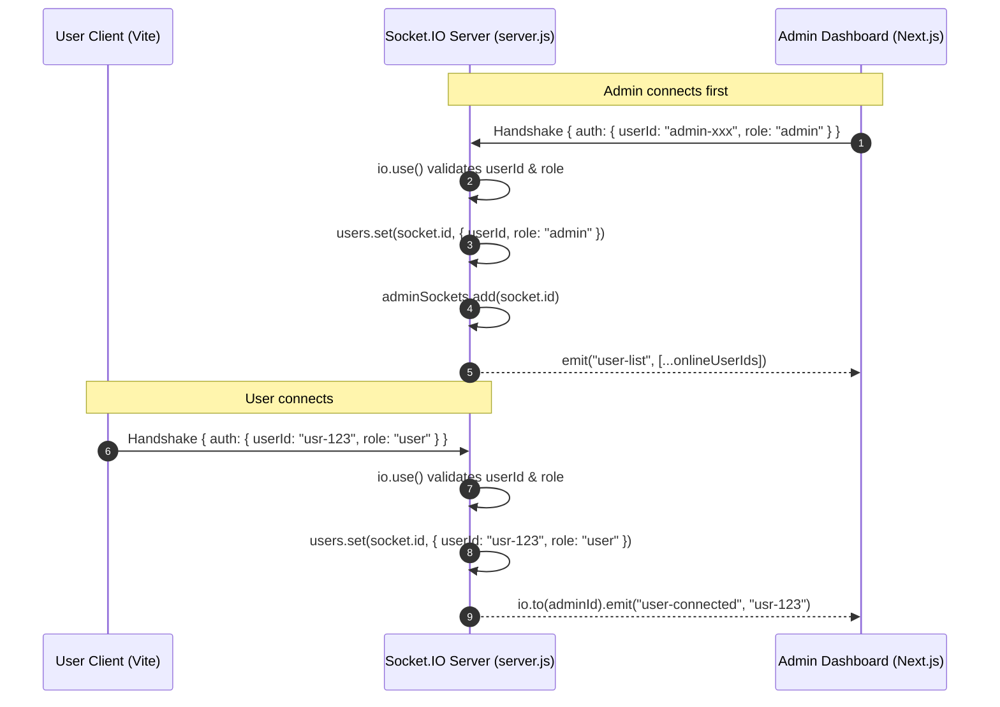
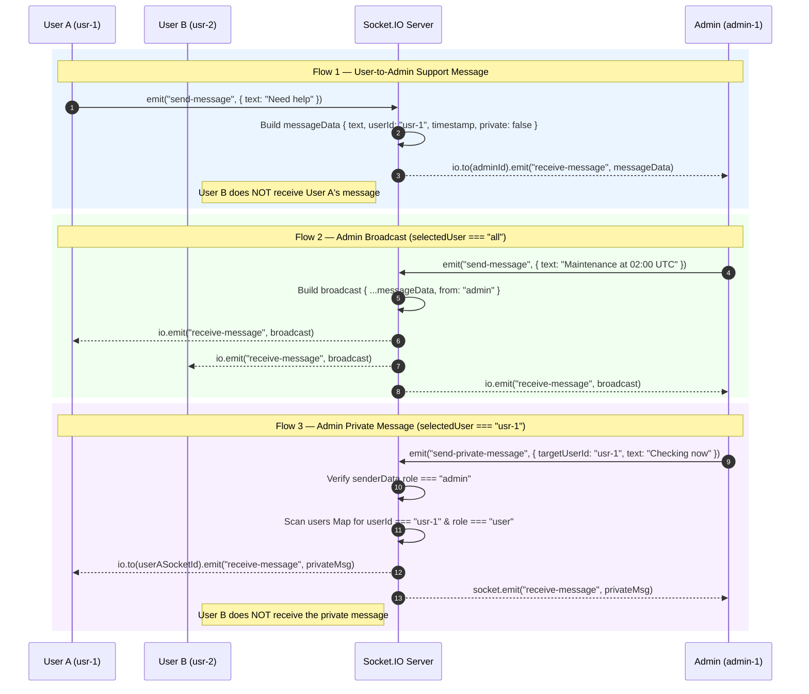
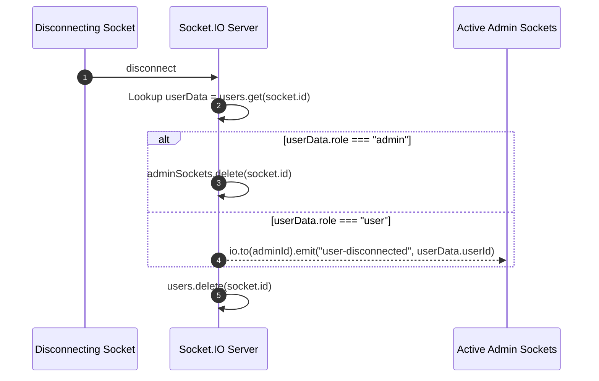

# System Design & Component Topology

*Status*: Living Architecture Specification  
*Scope*: `server.js`, `admin/index.js`, `client/index.js`

---

## 1. Overview

The **Realtime Communication System** implements a hub-and-spoke, role-segmented messaging topology over **Socket.IO v4** and **Express 4**. A single Node.js process terminates both HTTP requests (health checks) and bidirectional Socket.IO connections from two distinct client roles:

1. **End Users (`role: "user"`)**: Connect from a Vite/React client (`http://localhost:8080`) using `client/index.js`. Users send support messages to admins and receive admin broadcasts or private replies.
2. **Administrators (`role: "admin"`)**: Connect from a Next.js dashboard (`http://localhost:3000`) using `admin/index.js`. Admins observe live user presence, receive all user messages, broadcast to all connected clients, and send private messages to individual users.

---

## 2. Component & Network Topology



---

## 3. Core Communication Flows

### 3.1 Connection, Handshake Authentication & Presence Sync



### 3.2 Messaging Flows (User → Admin, Admin Broadcast, Admin Private)



### 3.3 Disconnection & Presence Cleanup



---

## 4. Client Connection State Machine

Both `admin/index.js` and `client/index.js` manage connection status through Socket.IO lifecycle events:

```mermaid
stateDiagram-v2
    [*] --> Idle: Component mounted
    Idle --> Connecting: autoConnect true\n(Admin always; User when user.id exists)
    Connecting --> AuthRejected: io.use() rejects\n("Authentication error")
    Connecting --> Connected: "connect" event\n(isConnected = true)
    Connected --> Disconnected: "disconnect" event\n(isConnected = false)
    Disconnected --> Connecting: Socket.IO auto-reconnect
    Connected --> [*]: Component unmount\n(socket.off + socket.disconnect)
    AuthRejected --> [*]
```



---

## 5. Protocol & API Contract

### 5.1 HTTP Endpoints

| Method | Path | Response Status | Response Body | Notes |
|---|---|---|---|---|
| `GET` | `/health` | `200 OK` | `{"status":"healthy","users":<number>,"admins":<number>}` | `users` reports `users.size` (total active sockets, including admins); `admins` reports `adminSockets.size`. |

### 5.2 Socket.IO Handshake Contract

Clients must supply an `auth` object during connection initialization:

```javascript
{
  userId: "string (non-empty)",
  role: "admin" | "user"
}
```

If either `userId` is falsy or `role` is not `"admin"` or `"user"`, `io.use()` rejects the handshake with `Error("Authentication error")`.

### 5.3 Socket.IO Event Reference

#### Client → Server Events

| Event | Allowed Roles | Input Payload | Server Action |
|---|---|---|---|
| `send-message` | `user`, `admin` | `{ text: string }` | If `user`: emits `receive-message` to every socket in `adminSockets`. If `admin`: broadcasts `receive-message` via `io.emit()` with `from: "admin"`. |
| `send-private-message` | `admin` only | `{ targetUserId: string, text: string }` | Silently ignored if sender is not `admin`. Finds first socket in `users` where `userId === targetUserId && role === "user"`. Emits `receive-message` to target socket and echoes back to sender socket. |

#### Server → Client Events

| Event | Recipients | Payload Schema | Trigger |
|---|---|---|---|
| `user-list` | Newly connected `admin` | `string[]` | Immediately upon admin connection. |
| `user-connected` | All `adminSockets` | `string` (`userId`) | When a `user` socket completes connection. |
| `user-disconnected` | All `adminSockets` | `string` (`userId`) | When a `user` socket disconnects. |
| `receive-message` | Target admins / all / target user + sender admin | `{ text: string, userId: string, timestamp: string, private: boolean, from?: "admin", targetUserId?: string }` | Triggered by `send-message` or `send-private-message`. |

---

## 6. Known Reference-Implementation Caveats & Scaling Path

Engineering teams adopting this boilerplate for production should note the following current behaviors:

1. **Client Socket Memoization**: In `admin/index.js` (line 23) and `client/index.js` (line 15), `io(...)` is invoked directly inside the React component body. In React apps with frequent re-renders, move socket initialization into a `useRef` or `useEffect` hook so only one socket connection is created per mounted component lifecycle.
2. **User Self-Echo on `send-message`**: When a `user` emits `send-message`, `server.js` forwards it only to `adminSockets` and does not echo it back to the user's own socket. Either echo back on the server (`socket.emit('receive-message', messageData)`) or append optimistically in `UserChatBox`.
3. **Multi-Tab User Sessions**: `send-private-message` breaks after finding the first matching socket for `targetUserId`. Users open in multiple tabs will only receive private messages on one socket unless routed via Socket.IO Rooms (`socket.join(\`user:${userId}\`)`).
4. **Horizontal Scaling**: Because `users` and `adminSockets` live in Node.js process memory, running multiple server instances behind a load balancer requires replacing in-memory routing with `@socket.io/redis-adapter` and Socket.IO Rooms. See [ADR-002](../adr/ADR-002-in-memory-connection-registry.md).
