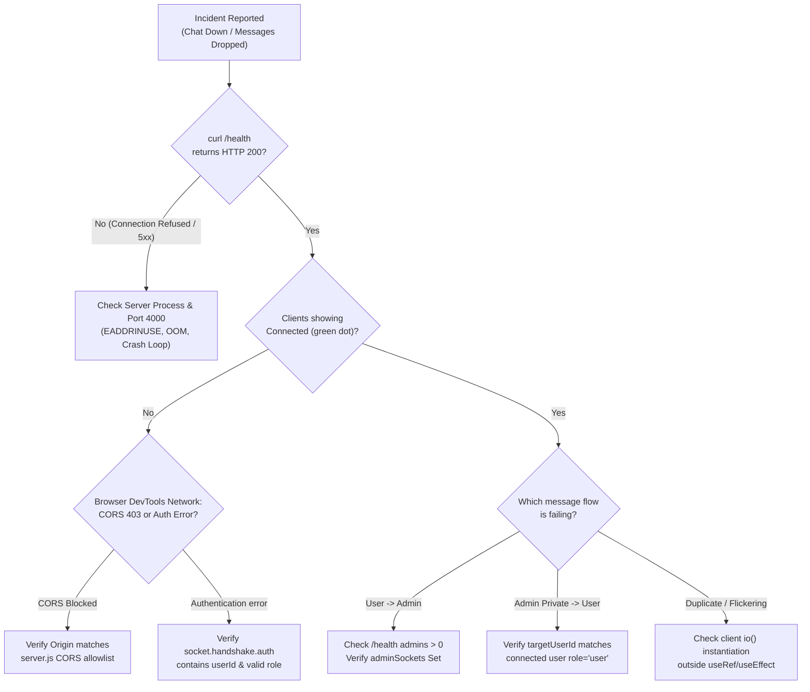

# Incident Response Runbook

*Tier 4 Operational Runbook* — Rapid triage, root-cause diagnostics, and recovery procedures for `realtime-comm` runtime incidents.

---

## 1. Triage Flowchart

---

## 2. Common Failure Modes & Remediation

### 2.1 `EADDRINUSE: address already in use :::4000`
- **Symptom**: Server crashes immediately on startup.
- **Cause**: Another process is already bound to `PORT` (default `4000`).
- **Diagnostics**:
  - Windows (PowerShell): `Get-NetTCPConnection -LocalPort 4000`
  - Linux/macOS: `lsof -i :4000`
- **Remediation**: Stop the conflicting process or start with an alternate port (`PORT=4001 npm run start-server`) and update client Socket.IO URLs accordingly.

### 2.2 Clients Stuck on "Disconnected" — `Authentication error`
- **Symptom**: Client never fires `connect`; `connect_error` reports `Authentication error`.
- **Cause**: `io.use()` rejected the handshake because `socket.handshake.auth.userId` was empty/undefined or `role` was neither `"admin"` nor `"user"`.
- **Remediation**:
  - For `client/index.js`, confirm `UserContext` (`useUser()`) resolves a non-empty `user.id` before connecting.
  - Inspect the Socket.IO handshake payload in browser DevTools → Network → WS.

### 2.3 CORS Policy Blocking Handshake
- **Symptom**: Browser console logs `Access to XMLHttpRequest at 'http://localhost:4000/socket.io/...' has been blocked by CORS policy`.
- **Cause**: Frontend is running on an origin not listed in `server.js` (`["http://localhost:8080", "http://localhost:3000"]`).
- **Remediation**: Add the frontend origin to both `app.use(cors(...))` and `new Server(server, { cors: ... })` in `server.js`, then restart the server.

### 2.4 Admin Private Message Not Delivered to User
- **Symptom**: Admin sends a private message, nothing appears on the user's screen (nor echoed to admin).
- **Cause**: Either the user disconnected before the message was sent, `targetUserId` does not match any active `role: "user"` entry in `users`, or the user has multiple open tabs and the message went to a different socket.
- **Remediation**: Confirm the user is still online via `GET /health` and the admin dropdown. For multi-tab reliability, migrate private delivery to Socket.IO Rooms (`socket.join(\`user:${userId}\`)`).

### 2.5 Duplicate Connections / Rapid Reconnect Churn
- **Symptom**: `GET /health` reports `users` count growing rapidly while only 1–2 browser tabs are open.
- **Cause**: `io('http://localhost:4000', ...)` inside `admin/index.js` or `client/index.js` is called on every React render rather than memoized in `useRef`.
- **Remediation**: Refactor client components to instantiate the socket once inside `useRef` or `useEffect` and clean it up on unmount.

---

## 3. Escalation & Post-Incident Actions

1. Capture server stdout/stderr logs and `GET /health` snapshots before restarting the process (in-memory state is lost on restart).
2. Restart the server cleanly (`npm run start-server`) and verify via [Deployment Verification Runbook](./deployment-verification.md).
3. If the incident revealed an architectural gap (e.g., single-node memory limit or missing auth control), open an issue using `.github/ISSUE_TEMPLATE/bug_report.md` and draft a superseding ADR in `docs/adr/`.
